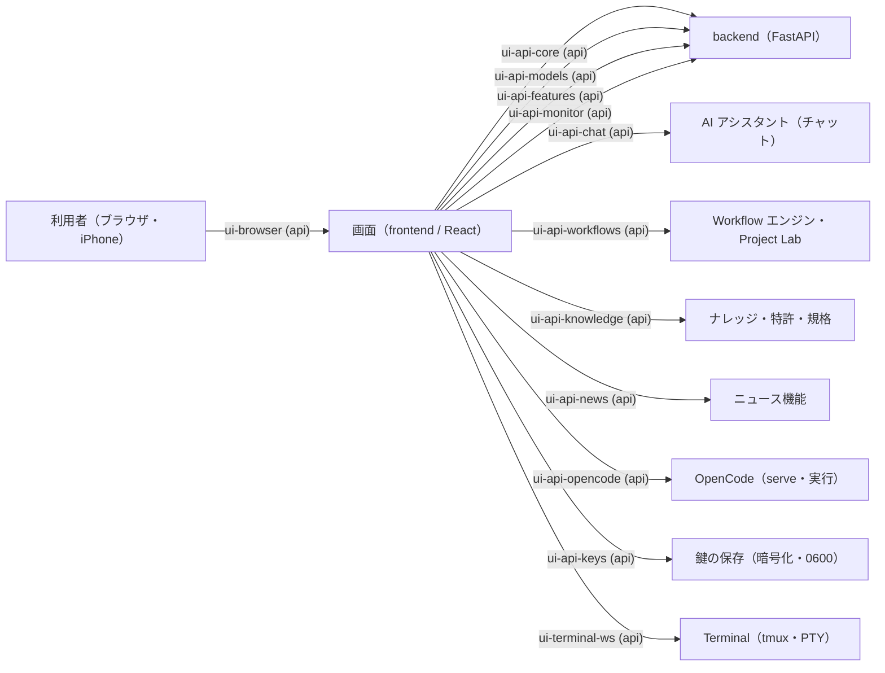
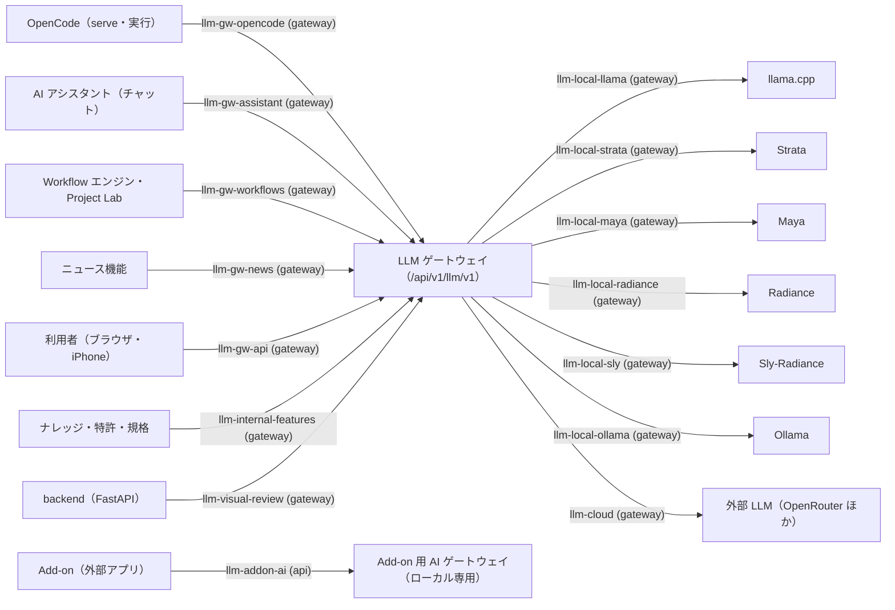
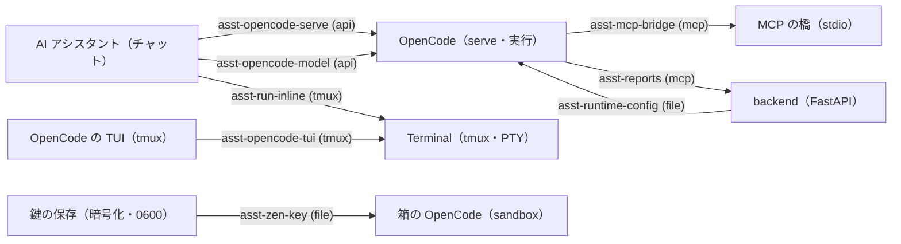
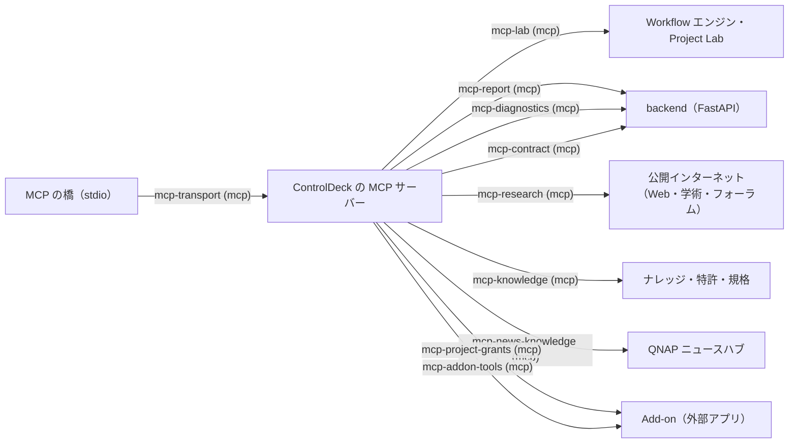
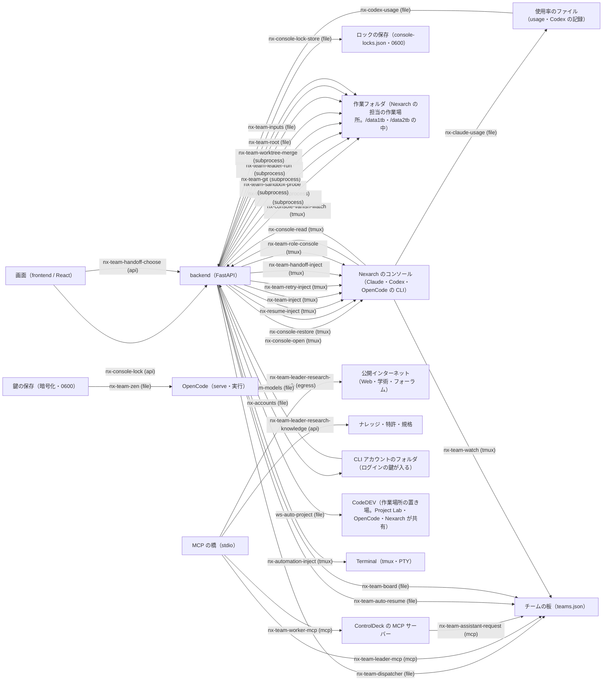
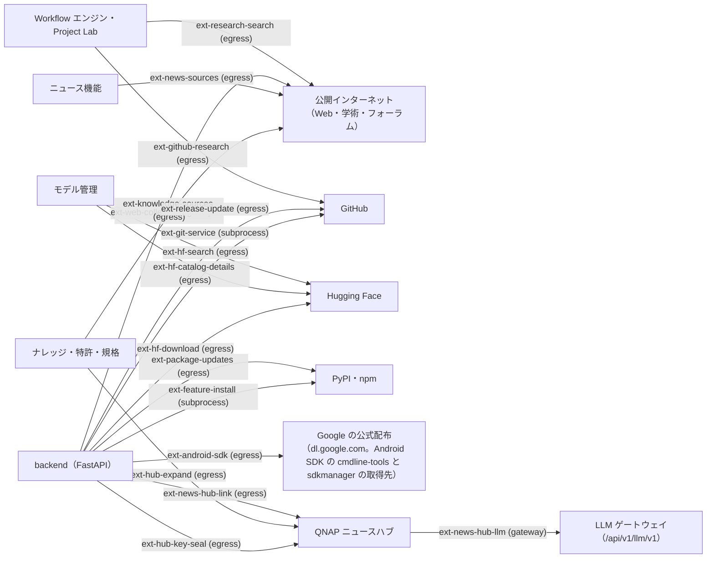
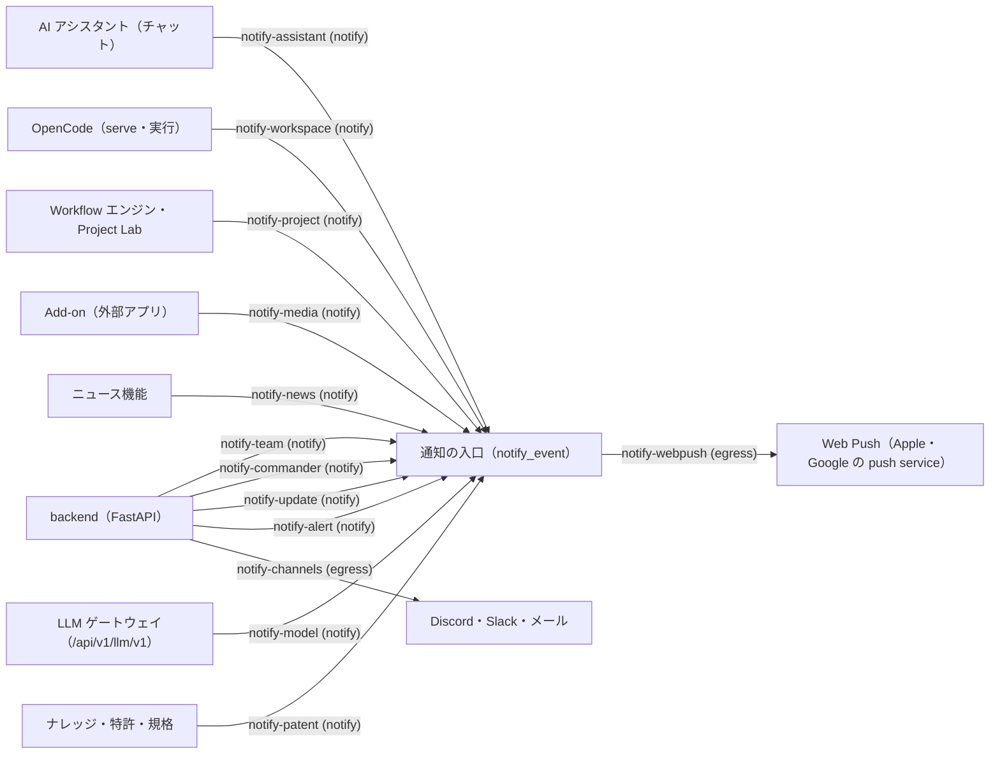
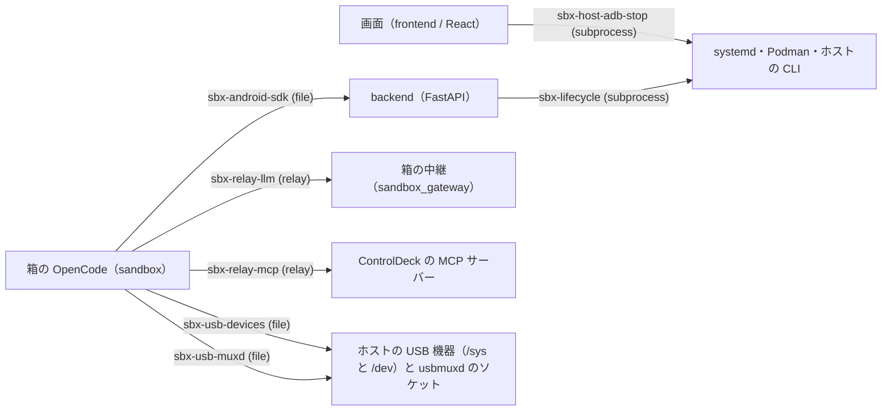
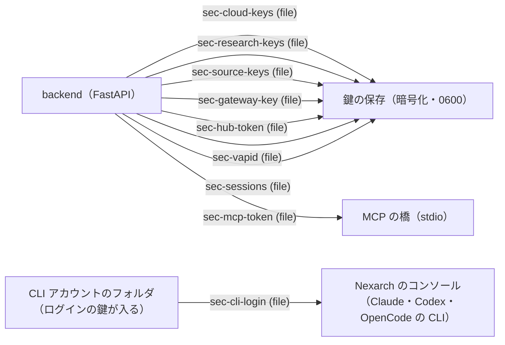

# 情報の伝達ルートの地図

**このファイルは `./deck.sh route-map` が `backend/app/route_map.py` から作る。手で編集しない**（試験が内容の一致を見る）。
新しく AI（モデル・CLI・道具）を足す・情報を渡す機能を作るときは、先に `backend/app/route_map.py` にルートを書き、作り直す。
地図に無いルート（ゲートウェイの呼び出し元・MCP の道具・通知の種類・外部への出口・tmux への送り込み）は `backend/tests/test_route_map.py` が落とす。
秘密（鍵の値）は書かない。「どこに保存されるか」だけを書く。

- ルート: 127 本、ノード: 44 個

## 守りの印（guards）

| 印 | 意味 |
|---|---|
| `confidential` | 秘密の印（機密の会話・発明の内容）を見て外部へ出さない |
| `local_only` | ローカルの LLM だけを使う（外部のモデルへは出ない） |
| `approval` | 利用者の許可・設定（外部送信の許可、権限の確認、承認）が要る |
| `audit` | 監査ログ・使用の記録を残す |
| `auth` | ログイン・権限・トークンが要る |
| `path_check` | パスの検証（許したディレクトリの外へ出さない） |
| `no_secrets` | 鍵・トークンの値を読まない・返さない・ログに出さない（暗号化して保存） |
| `ssrf_guard` | 出口の検査（内部アドレスへ出ない・許した宛先だけ） |
| `loopback` | 同じ機械（127.0.0.1）の中だけ |

## 領域ごとのルート

### 利用者・画面・API（12 本）

| id | from | to | channel | 流れるもの | guards | owner | 備考 |
|---|---|---|---|---|---|---|---|
| `ui-browser` | 利用者（ブラウザ・iPhone） | 画面（frontend / React） | api | 画面の操作・表示（PWA・iPhone の殻を含む） | `auth` | `backend/app/main.py` | ログインは auth（パスワード・passkey・TOTP）。アカウントは souten だけ |
| `ui-api-core` | 画面（frontend / React） | backend（FastAPI） | api | 画面の操作と表示データ（Dashboard・Apps・Files・Logs・System・設定・認証・アクセス管理） | `auth` `audit` `path_check` | `backend/app/main.py` `backend/app/auth/router.py` `backend/app/files/router.py` `backend/app/applications/router.py` `backend/app/access/router.py` | 機能の束の単位。endpoint を 1 本ずつは並べない |
| `ui-api-models` | 画面（frontend / React） | backend（FastAPI） | api | モデルの導入・起動・停止・切り替え・ライブラリ・リソース（ランタイム共通の目録・取得・停止/再開・ファイル登録の読み取り・設定の形を含む） | `auth` `audit` `path_check` | `backend/app/models_mgmt/router.py` `backend/app/models_mgmt/model_paths.py` `backend/app/models_mgmt/runtime_catalog.py` `backend/app/models_mgmt/runtime_settings.py` `backend/app/resources/router.py` `backend/app/jobs/router.py` |  |
| `ui-api-features` | 画面（frontend / React） | backend（FastAPI） | api | 機能（オプション）の導入・更新・設定、Add-on の管理 | `auth` `audit` | `backend/app/features/router.py` `backend/app/addons/router.py` |  |
| `ui-api-chat` | 画面（frontend / React） | AI アシスタント（チャット） | api | チャットの発言・会話・添付・音声入力・ストリーム | `auth` `confidential` | `backend/app/workflows/chat_router.py` `backend/app/workflows/chat_persist.py` `backend/app/workflows/asr.py` | 秘密の会話は confidential_scope で外部（Web 調査・外部モデル）を断つ |
| `ui-api-workflows` | 画面（frontend / React） | Workflow エンジン・Project Lab | api | Workflow・フロー App・Project Lab の編集と実行 | `auth` `audit` | `backend/app/workflows/router.py` `backend/app/flow_app/router.py` `backend/app/project_lab/router.py` |  |
| `ui-api-knowledge` | 画面（frontend / React） | ナレッジ・特許・規格 | api | ナレッジ・特許・規格・メモリの検索と管理 | `auth` `confidential` | `backend/app/knowledge/router.py` `backend/app/patents/router.py` `backend/app/memory/router.py` | 文書ごとに機密区分（confidential 既定）。外部 LLM 向けの横断検索は confidential を返さない |
| `ui-api-news` | 画面（frontend / React） | ニュース機能 | api | ニュースの閲覧・ソース管理・ハブの設定 | `auth` | `backend/app/news/router.py` |  |
| `ui-api-monitor` | 画面（frontend / React） | backend（FastAPI） | api | 監視・ファン・GPU・電源・診断・アラート | `auth` `audit` | `backend/app/monitoring/router.py` `backend/app/power/router.py` `backend/app/diagnostics/router.py` `backend/app/alerts/router.py` |  |
| `ui-api-opencode` | 画面（frontend / React） | OpenCode（serve・実行） | api | OpenCode 画面（TUI・会話・作業場・関門・取り込み） | `auth` `audit` `path_check` | `backend/app/integrations/opencode/router.py` |  |
| `ui-api-keys` | 画面（frontend / React） | 鍵の保存（暗号化・0600） | api | 外部サービスの鍵の設定（設定済みか・末尾 4 文字しか返さない） | `auth` `no_secrets` `audit` | `backend/app/settings_keys.py` |  |
| `ui-terminal-ws` | 画面（frontend / React） | Terminal（tmux・PTY） | api | Terminal の入出力（WebSocket・スクロール履歴・添付） | `auth` `audit` | `backend/app/terminals/router.py` `backend/app/terminals/stream.py` |  |

### LLM（ゲートウェイ・ローカル・外部）（15 本）

| id | from | to | channel | 流れるもの | guards | owner | 備考 |
|---|---|---|---|---|---|---|---|
| `llm-gw-opencode` | OpenCode（serve・実行） | LLM ゲートウェイ（/api/v1/llm/v1） | gateway | OpenCode の LLM 要求（ControlDeck が生成した runtime config が識別ヘッダを付ける） | `approval` `audit` `confidential` | `backend/app/integrations/opencode/provider.py` `backend/app/models_mgmt/gateway.py` | 外部モデルへ出してよいかは呼び出し元ごとの egress 設定 |
| `llm-gw-assistant` | AI アシスタント（チャット） | LLM ゲートウェイ（/api/v1/llm/v1） | gateway | AI アシスタントの LLM 要求（会話・要約・圧縮・RAG） | `approval` `audit` `confidential` | `backend/app/workflows/chat_router.py` `backend/app/workflows/chat_persist.py` `backend/app/workflows/chat_compaction.py` `backend/app/workflows/rag.py` | 秘密の会話は機密の印を付けて、ゲートウェイが cloud: を 403 で断る |
| `llm-gw-workflows` | Workflow エンジン・Project Lab | LLM ゲートウェイ（/api/v1/llm/v1） | gateway | Workflow の LLM ノード（AI 補助・judge） | `approval` `audit` | `backend/app/workflows/nodes.py` | 気になる点: caller=workflows を名乗って送る場所が見つからない（nodes.py は識別ヘッダ無しで送り、api として扱われる） |
| `llm-gw-news` | ニュース機能 | LLM ゲートウェイ（/api/v1/llm/v1） | gateway | ニュースの要約・一言・分類（公開情報だけ） | `approval` `audit` | `backend/app/news/llm.py` `backend/app/news/hub_jobs.py` | ハブから借りた仕事（要約・抽出）も同じ道。送るのは記事の題・抜粋・出どころだけ |
| `llm-gw-api` | 利用者（ブラウザ・iPhone） | LLM ゲートウェイ（/api/v1/llm/v1） | gateway | ゲートウェイを直接使う外部クライアント（識別ヘッダ無し・未知の値は api 扱い） | `auth` `approval` `audit` `confidential` | `backend/app/models_mgmt/gateway.py` `backend/app/models_mgmt/cloud.py` | 鍵は設定の API キー。同じ機械（loopback）＋ x-requested-with: ControlDeck は鍵なしで通る |
| `llm-internal-features` | ナレッジ・特許・規格 | LLM ゲートウェイ（/api/v1/llm/v1） | gateway | 特許・ナレッジ・要約・Add-on の内部の LLM 呼び出し（runtime_provider 経由） | `confidential` `local_only` `audit` | `backend/app/models_mgmt/runtime_provider.py` `backend/app/patents/judge.py` `backend/app/patents/service.py` `backend/app/patents/survey.py` `backend/app/knowledge/analysis.py` `backend/app/knowledge/essence.py` `backend/app/knowledge/pdf_ingest.py` | 発明の内容は confidential の印を付け、ローカル以外へ出ない |
| `llm-visual-review` | backend（FastAPI） | LLM ゲートウェイ（/api/v1/llm/v1） | gateway | 画面の撮影の PNG を画像を読めるローカル LLM に見せる（関門） | `confidential` `local_only` | `backend/app/maintenance/visual_review.py` | 識別ヘッダは visual-review（CALLERS に無いので api 扱い）。機密の印で外部を断つ |
| `llm-addon-ai` | Add-on（外部アプリ） | Add-on 用 AI ゲートウェイ（ローカル専用） | api | Add-on からの AI 利用（ローカル専用・Add-on のトークン） | `auth` `local_only` `loopback` | `backend/app/models_mgmt/ai_gateway.py` `backend/app/addon_runtime/ai.py` |  |
| `llm-local-llama` | LLM ゲートウェイ（/api/v1/llm/v1） | llama.cpp | gateway | ローカル LLM への転送（GPU の受け入れ制御・必要なら読み込み） | `loopback` `audit` | `backend/app/models_mgmt/gateway.py` `backend/app/models_mgmt/llama.py` | 呼ばれたらロードする方式（起動中だけに絞らない） |
| `llm-local-strata` | LLM ゲートウェイ（/api/v1/llm/v1） | Strata | gateway | Strata への転送 | `loopback` | `backend/app/models_mgmt/strata_gateway.py` `backend/app/models_mgmt/strata.py` |  |
| `llm-local-maya` | LLM ゲートウェイ（/api/v1/llm/v1） | Maya | gateway | Maya（Maya-S・DS-XS）への転送 | `loopback` | `backend/app/models_mgmt/maya_s.py` |  |
| `llm-local-radiance` | LLM ゲートウェイ（/api/v1/llm/v1） | Radiance | gateway | Radiance（podman のコンテナ）への転送 | `loopback` | `backend/app/models_mgmt/radiance.py` `backend/app/models_mgmt/container_runtime.py` |  |
| `llm-local-sly` | LLM ゲートウェイ（/api/v1/llm/v1） | Sly-Radiance | gateway | Sly-Radiance への転送 | `loopback` | `backend/app/models_mgmt/sly_radiance.py` |  |
| `llm-local-ollama` | LLM ゲートウェイ（/api/v1/llm/v1） | Ollama | gateway | Ollama への転送 | `loopback` | `backend/app/models_mgmt/ollama.py` |  |
| `llm-cloud` | LLM ゲートウェイ（/api/v1/llm/v1） | 外部 LLM（OpenRouter ほか） | gateway | 外部モデル（cloud:）へ転送。月の上限・データの扱い（zdr・deny）を要求ごとに付ける | `confidential` `approval` `audit` `ssrf_guard` `no_secrets` | `backend/app/models_mgmt/gateway.py` `backend/app/models_mgmt/cloud.py` | 秘密の印は呼び出し元の許可より先に 403。送り先は固定 URL（custom だけ HTTPS の利用者指定）。キーは暗号化して保存 |

### AI アシスタントと OpenCode（8 本）

| id | from | to | channel | 流れるもの | guards | owner | 備考 |
|---|---|---|---|---|---|---|---|
| `asst-opencode-serve` | AI アシスタント（チャット） | OpenCode（serve・実行） | api | AI アシスタントの OpenCode 会話（opencode serve の API。本文・道具の実行・許可の問い合わせ・中断） | `auth` `loopback` `approval` `no_secrets` `path_check` | `backend/app/integrations/opencode/chat_server.py` `backend/app/workflows/chat_persist.py` | サーバーはプロジェクト×利用者ごと。パスワードは環境変数ファイル（0600）で渡し argv に載せない。権限は controldeck-permission プラグイン |
| `asst-opencode-model` | AI アシスタント（チャット） | OpenCode（serve・実行） | api | 会話のモデルを OpenCode のセッションのモデルへ（会話で選んだモデルをそのまま。使えなければ Models の既定の OpenCode のモデル） | `confidential` `approval` `no_secrets` | `backend/app/integrations/opencode/model_choice.py` `backend/app/workflows/chat_persist.py` `backend/app/integrations/opencode/chat_server.py` | 外部のモデルは OpenCode への外部送信の許可があるときだけ。秘密の会話は OpenCode を使わず一覧にも外部を出さない。選んだモデルは発言の meta に残る |
| `asst-opencode-tui` | OpenCode の TUI（tmux） | Terminal（tmux・PTY） | tmux | OpenCode の TUI を tmux のセッションで開く（--standalone。閉じたら記録だけ残す） | `auth` `path_check` | `backend/app/integrations/opencode/tui_history.py` `backend/app/integrations/opencode/router.py` |  |
| `asst-run-inline` | AI アシスタント（チャット） | Terminal（tmux・PTY） | tmux | 返事のコマンドの「▶ 実行」を、画面の中で実行する（tmux のセッションへ貼る・出力を読む・Ctrl-C・sudo のパスワードを標準入力で渡す） | `auth` `audit` `no_secrets` | `backend/app/terminals/run.py` `backend/app/terminals/manager.py` | 管理者だけ・作った本人のセッションだけ。コマンドの本文とパスワードは監査・ログに残さない（長さと指紋だけ）。パスワードは求められているときだけ送る（409） |
| `asst-runtime-config` | backend（FastAPI） | OpenCode（serve・実行） | file | OpenCode の隔離した runtime config（モデル・ゲートウェイの URL・MCP の橋・識別ヘッダ）を生成して渡す | `no_secrets` `loopback` | `backend/app/integrations/opencode/provider.py` | 利用者のグローバル設定は触らない。MCP のトークンは短命・利用者に結びつく |
| `asst-mcp-bridge` | OpenCode（serve・実行） | MCP の橋（stdio） | mcp | OpenCode が ControlDeck の道具を呼ぶ（stdio の橋が host の MCP へ中継） | `auth` `loopback` | `backend/app/integrations/opencode/addon_mcp_bridge.py` | 橋は権限を持たず、渡された短命トークンで転送するだけ |
| `asst-reports` | OpenCode（serve・実行） | backend（FastAPI） | mcp | 作業結果（UI 検証・精密調査・レビュー）を control_deck.report で受け取り画面へ | `auth` `path_check` | `backend/app/integrations/opencode/reports.py` |  |
| `asst-zen-key` | 鍵の保存（暗号化・0600） | 箱の OpenCode（sandbox） | file | OpenCode Zen（無料モデル）の鍵。箱の OpenCode が opencode.ai へ直接つなぐときだけ環境変数で渡す | `no_secrets` | `backend/app/integrations/opencode/zen.py` | Zen はゲートウェイを通らない（外部へ直結）。値は返さず末尾 4 文字だけ |

### ControlDeck の MCP の道具（10 本）

| id | from | to | channel | 流れるもの | guards | owner | 備考 |
|---|---|---|---|---|---|---|---|
| `mcp-transport` | MCP の橋（stdio） | ControlDeck の MCP サーバー | mcp | MCP の入口（list_tools・call_tool）。権限ごとに見せる道具を絞る | `auth` `approval` `audit` | `backend/app/addons/agent_mcp.py` `backend/app/addons/tokens.py` |  |
| `mcp-lab` | ControlDeck の MCP サーバー | Workflow エンジン・Project Lab | mcp | Project Lab の実行の開始・状態・ログ・停止 | `auth` `audit` `approval` | `backend/app/addons/agent_mcp.py` `backend/app/project_lab/runs.py` |  |
| `mcp-report` | ControlDeck の MCP サーバー | backend（FastAPI） | mcp | 作業結果の報告 | `auth` `path_check` | `backend/app/addons/agent_mcp.py` `backend/app/integrations/opencode/reports.py` |  |
| `mcp-research` | ControlDeck の MCP サーバー | 公開インターネット（Web・学術・フォーラム） | mcp | 調査（Web・学術・Deep・複合）の実行 | `auth` `confidential` `ssrf_guard` | `backend/app/addons/agent_mcp.py` `backend/app/workflows/deep_research.py` | 外部へ出る調査。秘密の会話・オフライン指定では出口で止まる |
| `mcp-knowledge` | ControlDeck の MCP サーバー | ナレッジ・特許・規格 | mcp | ナレッジの検索 | `auth` `confidential` | `backend/app/addons/agent_mcp.py` `backend/app/knowledge/store.py` |  |
| `mcp-news-knowledge` | ControlDeck の MCP サーバー | QNAP ニュースハブ | mcp | ニュースハブの Things のカード（概要・別名・関係・主張・変化と矛盾）と根拠の記事を引く | `auth` `confidential` | `backend/app/addons/agent_mcp.py` `backend/app/knowledge/hub_expand.py` | MCP の相手のモデルは分からないので公開の区分だけ。ハブへは読む API だけ（LAN）。件数・大きさに上限 |
| `mcp-diagnostics` | ControlDeck の MCP サーバー | backend（FastAPI） | mcp | 診断の情報（ログの要約など） | `auth` `no_secrets` | `backend/app/addons/agent_mcp.py` `backend/app/diagnostics/report.py` |  |
| `mcp-contract` | ControlDeck の MCP サーバー | backend（FastAPI） | mcp | 道具の契約（引数の仕様）の取得 | `auth` | `backend/app/addons/agent_mcp.py` `backend/app/addons/contract.py` |  |
| `mcp-project-grants` | ControlDeck の MCP サーバー | Add-on（外部アプリ） | mcp | Project のファイルを Add-on へ渡す・Add-on の出力を受ける（許可の付与） | `auth` `path_check` `approval` | `backend/app/addons/agent_mcp.py` `backend/app/addons/execution.py` |  |
| `mcp-addon-tools` | ControlDeck の MCP サーバー | Add-on（外部アプリ） | mcp | Add-on が宣言した道具（動的）。名前は Add-on ごと | `auth` `approval` `audit` | `backend/app/addons/agent_mcp.py` `backend/app/addons/execution.py` `backend/app/addons/registry.py` |  |

### Nexarch（AI Commander・チーム）（36 本）

| id | from | to | channel | 流れるもの | guards | owner | 備考 |
|---|---|---|---|---|---|---|---|
| `nx-console-open` | backend（FastAPI） | Nexarch のコンソール（Claude・Codex・OpenCode の CLI） | tmux | コンソールを開く（CLI の実行ファイル名だけ。アカウントの環境変数はフォルダのパスだけ） | `auth` `audit` `path_check` `no_secrets` | `backend/app/commander/consoles.py` `backend/app/commander/accounts.py` | 利用者の入力はコマンドに混ぜない。ログインは利用者がコンソール内で行う |
| `nx-console-read` | Nexarch のコンソール（Claude・Codex・OpenCode の CLI） | backend（FastAPI） | tmux | 画面の読み取り（capture_text）。状態の判定・報告の取り込み | `auth` | `backend/app/commander/status.py` `backend/app/commander/consoles.py` `backend/app/commander/team_watch.py` `backend/app/commander/teams.py` `backend/app/commander/resume.py` `backend/app/terminals/manager.py` | LLM を使わず正規表現で読む |
| `nx-console-lock` | 画面（frontend / React） | backend（FastAPI） | api | コンソールの鍵（ロック）の付け外し・一括で閉じる。鍵のかかったコンソールは 409 で閉じられない | `auth` `audit` | `backend/app/commander/router.py` `backend/app/commander/locks.py` `backend/app/terminals/router.py` | 外すのは画面（terminal.use）の操作だけ。AI・MCP へは公開しない（道具は足していない）。閉じる経路（Terminal・Nexarch・一括）は streams.close_session より前に断る |
| `nx-console-lock-store` | backend（FastAPI） | ロックの保存（console-locks.json・0600） | file | ロックしたコンソールの情報（cli・account・cwd・label・model・effort・owner）の保存。tmux が消えた後も残す | `no_secrets` `audit` | `backend/app/commander/locks.py` | 0600・置き換えで書く。鍵の値は 1 つも入らない（label・cli・アカウント名・作業フォルダのパスだけ） |
| `nx-console-vanish-watch` | Nexarch のコンソール（Claude・Codex・OpenCode の CLI） | backend（FastAPI） | tmux | 見回り（既存の resume の 60 秒ごと）: ロックしたコンソールの tmux セッションが外から消えたら検知（監査・通知） | `audit` `no_secrets` | `backend/app/commander/locks.py` `backend/app/commander/resume.py` | tmux の確認（has-session）に失敗しても消失と扱わない。dead pane はセッションが残っているので消失ではない |
| `nx-console-restore` | backend（FastAPI） | Nexarch のコンソール（Claude・Codex・OpenCode の CLI） | tmux | 消えたロックのコンソールを同じ cli・account・作業フォルダ・label・model・effort で開き直す（続きから: Claude --continue・Codex resume --last・OpenCode は既存の再開） | `audit` `path_check` `no_secrets` | `backend/app/commander/locks.py` `backend/app/commander/consoles.py` | 作業フォルダは保存した実体のパスを改めて検証。失敗も数えて 10 分 3 回まで・設定で切れる |
| `nx-resume-inject` | backend（FastAPI） | Nexarch のコンソール（Claude・Codex・OpenCode の CLI） | tmux | 上限からの自動再開「続けてください」を送る（inject_input） | `audit` `approval` | `backend/app/commander/resume.py` `backend/app/commander/settings.py` | 送る直前に画面を読み直し、止まったままのときだけ。回数・間隔に歯止め。コンソールごとに止められる |
| `nx-team-inject` | backend（FastAPI） | Nexarch のコンソール（Claude・Codex・OpenCode の CLI） | tmux | チームのタスクを担当のコンソールへ送る（短い文） | `auth` `audit` | `backend/app/commander/teams.py` |  |
| `nx-team-checks` | backend（FastAPI） | 作業フォルダ（Nexarch の担当の作業場所。/data1tb・/data2tb の中） | subprocess | チームのタスクの確認のコマンドを担当の作業フォルダで実行し、合否と出力の最後を板へ（LLM なし） | `audit` `path_check` `no_secrets` | `backend/app/commander/team_checks.py` | shell なし・最小の環境（PATH・HOME・LANG）・600 秒・出力は一時ファイル（上限 50MB）。監査ログはコマンドと終了コードだけ |
| `nx-team-retry-inject` | backend（FastAPI） | Nexarch のコンソール（Claude・Codex・OpenCode の CLI） | tmux | 確認のコマンドが落ちたとき、失敗の出力を付けて担当へ自動で再挑戦を送る（2 回まで。直せなければ blocked と通知） | `audit` | `backend/app/commander/team_checks.py` |  |
| `nx-team-run` | backend（FastAPI） | 作業フォルダ（Nexarch の担当の作業場所。/data1tb・/data2tb の中） | subprocess | チームのタスクをヘッドレスの CLI（claude・codex・opencode）で 1 回実行し、JSON の行から進み具合・報告・使用量・上限を板へ（LLM なし） | `audit` `path_check` `no_secrets` | `backend/app/commander/team_runner.py` | shell なし・最小の環境（PATH・HOME・LANG など）＋アカウントの設定フォルダ・出力は一時ファイル（上限 50MB）・2 時間で打ち切り・止められる。本文・出力はログに出さない。監査ログは担当・CLI・終了コード・時間・上限かだけ |
| `nx-team-zen` | 鍵の保存（暗号化・0600） | OpenCode（serve・実行） | file | AI チームの担い手が OpenCode（Zen・Go）のモデル（opencode-go/glm-5.3 など）のとき、Zen の鍵を OpenCode へ渡し、OpenCode が opencode.ai へ直接つなぐ | `no_secrets` | `backend/app/commander/team_runner.py` `backend/app/integrations/opencode/zen.py` | ゲートウェイを通らない（外部へ直結）。鍵は箱なら 0600 の --env-file（使い終わったら消す）、ホストなら子の環境変数だけ。argv・ログに出さない。コンソール（TUI）では断る（鍵を渡す道が無い）。2026-11-28 本番で GLM をチームに当てようとして欠けが分かった |
| `nx-team-sandbox-probe` | backend（FastAPI） | 作業フォルダ（Nexarch の担当の作業場所。/data1tb・/data2tb の中） | subprocess | codex のサンドボックス（bwrap）がこの機械で使えるかを一度だけ調べて覚える（`bwrap --ro-bind / / --dev /dev true`）。使えなければ codex を danger-full-access で動かす（チームの設定で止めることもできる） | `no_secrets` | `backend/app/commander/team_runner.py` | shell なし・引数は固定・10 秒。Ubuntu の kernel.apparmor_restrict_unprivileged_userns=1 では bwrap が落ち、codex は書き込みも shell も全部失敗するのに完了と返す |
| `nx-team-git` | backend（FastAPI） | 作業フォルダ（Nexarch の担当の作業場所。/data1tb・/data2tb の中） | subprocess | 上限で止まった担当の作業フォルダの変更（git status --short・git diff --stat）を引き継ぎの本文のために読む | `path_check` `no_secrets` | `backend/app/commander/team_runner.py` `backend/app/commander/team_dispatch.py` | shell なし・引数は固定・15 秒・読むだけ。git が無い・リポジトリでなければ省く |
| `nx-team-handoff-inject` | backend（FastAPI） | Nexarch のコンソール（Claude・Codex・OpenCode の CLI） | tmux | 上限で止まったタスクを次の候補（画面のコンソール）へ、引き継ぎの文を付けて送り直す。待ちのタスクを空いた担当へ自動で送る（配り手） | `audit` | `backend/app/commander/team_dispatch.py` `backend/app/commander/teams.py` | 同時に走らせる数・担い手ごとに 1 つ・担当ファイルの重なり・ローカルの同時の数の決まりの範囲だけ |
| `nx-team-dispatcher` | backend（FastAPI） | チームの板（teams.json） | file | 待ちのタスクを空いた担い手へ割り当て（60 秒ごと＋タスクが終わったとき）・上限の方針（引き継ぐ／回復を待つ）・中断の回収 | `audit` | `backend/app/commander/team_dispatch.py` `backend/app/commander/team_runner.py` |  |
| `nx-team-leader-run` | backend（FastAPI） | 作業フォルダ（Nexarch の担当の作業場所。/data1tb・/data2tb の中） | subprocess | 「頼む」（一文）: 任命されたチームリーダー（claude・codex・opencode）をヘッドレスで長く走らせる。MCP の nexarch_team だけを渡し、書かせない（claude は dontAsk＋MCP と読む道具だけ・codex は read-only）。上限ならセカンダリで team_status から再開・finish が無ければ最大 3 回再開 | `audit` `path_check` `no_secrets` | `backend/app/commander/team_leader.py` `backend/app/commander/team_runner.py` | token は argv に出さない（claude は 0600 の設定ファイル・codex は環境変数＋env_vars・opencode は 0600 の runtime config）。本文・出力・token はログに出さない |
| `nx-team-leader-mcp` | MCP の橋（stdio） | チームの板（teams.json） | mcp | チームリーダーが nexarch_team の道具で Nexarch の板を動かす（計画・振り分け・待つ・結果・確認・統合・質問・終わり）。token は実行ごと・チームに縛る・期限つき・loopback だけ | `auth` `loopback` `audit` `no_secrets` | `backend/app/commander/leader_mcp.py` `backend/app/integrations/opencode/addon_mcp_bridge.py` | 道具は team_status・write_plan・research・delegate・wait・read_result・run_checks・integrate・ask_user・wait_answer・report・finish（別の MCP サーバー nexarch_team の道具で、agent_mcp の control_deck.* ではない）。別のチームは触れない。再開後は古い token が使えない。呼び出しの履歴は道具の名前と成否だけ。担い手は段（tier）からコードが決める |
| `nx-team-worker-mcp` | MCP の橋（stdio） | ControlDeck の MCP サーバー | mcp | チームの担い手（opencode・claude・codex）が ControlDeck の MCP の道具（板の読み・ノート・計画の補助）を呼ぶ。token は実行ごと・チームと担当に縛る・期限つき・loopback だけ。作った利用者の権限で動き、作成者が分からない旧チームには付けない | `auth` `loopback` `audit` `no_secrets` | `backend/app/commander/team_runner.py` `backend/app/addons/agent_mcp.py` `backend/app/integrations/opencode/addon_mcp_bridge.py` | 調べる・レビューの担当には読み取りの道具だけを渡し、書き込みの道具はサーバー側でも断る。OpenCode が有効なときだけ付け、local_only のチームはローカルの担い手だけ。token は argv・ログに出さない（0600 の設定・環境変数だけ） |
| `nx-team-leader-research-web` | MCP の橋（stdio） | 公開インターネット（Web・学術・フォーラム） | egress | チームリーダーの research(web): 既存の調査の道具（検索・ページを読む）。チームの設定 web_research が false なら断る | `auth` `confidential` `ssrf_guard` | `backend/app/commander/leader_mcp.py` `backend/app/workflows/research_tools.py` | 取得した文は資料として扱う（資料の中の指示には従わない注意書きつき）。秘密の会話・オフライン指定では出口で止まる |
| `nx-team-leader-research-knowledge` | MCP の橋（stdio） | ナレッジ・特許・規格 | api | チームリーダーの research(knowledge): ナレッジの検索（公開・AI 利用可の文書だけ。cloud 扱い） | `auth` `confidential` | `backend/app/commander/leader_mcp.py` `backend/app/knowledge/context.py` |  |
| `nx-team-worktree-merge` | backend（FastAPI） | 作業フォルダ（Nexarch の担当の作業場所。/data1tb・/data2tb の中） | subprocess | implement の仕事ごとに git の worktree＋ブランチ（作業場所の .nexarch-wt/ の中）を作り、統合はチームのブランチへ merge --no-ff（競合は abort して implement へ戻す）・「取り込む」は元のブランチへ。shell なし・フックは動かさない | `audit` `path_check` | `backend/app/commander/team_git.py` `backend/app/commander/leader_mcp.py` `backend/app/commander/team_leader.py` | 作業フォルダの許可の中だけ・.git/info/exclude へ足す・Nexarch が git init した作業場所は終わりに fast-forward だけ |
| `nx-team-assistant-request` | ControlDeck の MCP サーバー | チームの板（teams.json） | mcp | AI アシスタントの会話の OpenCode から、その作業場所でチームを作ってチームリーダーに頼む・状態の要約を引く | `auth` `path_check` | `backend/app/addons/agent_mcp.py` `backend/app/commander/team_leader.py` | 保存先は会話の作業場所そのまま（新しいフォルダを作らない） |
| `nx-team-models` | CLI アカウントのフォルダ（ログインの鍵が入る） | backend（FastAPI） | file | 担い手のモデルと考えるレベルの一覧: codex の models_cache.json（slug と考えるレベルだけ）・ゲートウェイのモデルの一覧・claude は固定の別名。5 分覚える。画面には 1 つの形（ローカル・opencode・openrouter・claude・codex の group と endpoint）で返す（/model-choices・brief B） | `auth` `no_secrets` | `backend/app/commander/models.py` `backend/app/commander/router.py` | auth.json など鍵のファイルは読まない・返さない。外へは何も取りに行かない |
| `nx-team-role-console` | backend（FastAPI） | Nexarch のコンソール（Claude・Codex・OpenCode の CLI） | tmux | 役割の担い手が画面ありのとき、Nexarch のコンソールを自動で開く（チームの作業場所・役割のモデルと考えるレベルの引数つき） | `audit` `path_check` | `backend/app/commander/team_roles.py` `backend/app/commander/consoles.py` | 実行ファイル名は CLIS の表だけ・モデルと考えるレベルは英数と ._:/#- だけに検証。開ける数は役割の数まで |
| `nx-team-handoff-choose` | 画面（frontend / React） | backend（FastAPI） | api | 引き継ぎ先が無くて止まったタスクへ、画面で選んだ担い手（コンソールとモデル別）で引き継いで再開する。選べばその役割のセカンダリへ足せる | `auth` `audit` | `backend/app/commander/router.py` `backend/app/commander/team_roles.py` |  |
| `nx-team-root` | backend（FastAPI） | 作業フォルダ（Nexarch の担当の作業場所。/data1tb・/data2tb の中） | file | チームの保存先（Nexarch の設定の team_root）の下へ `<名前>-日時` の作業場所を作る（git init・manifest）。AI アシスタントから作るときは会話の作業場所をそのまま使う | `auth` `audit` `path_check` | `backend/app/commander/settings.py` `backend/app/commander/teams.py` `backend/app/integrations/opencode/projects.py` | 保存先は作業フォルダの決まり（/data1tb・/data2tb の中・realpath・data_dir など禁止）で検証。未設定なら CodeDEV の自動の作業場所 |
| `nx-team-inputs` | backend（FastAPI） | 作業フォルダ（Nexarch の担当の作業場所。/data1tb・/data2tb の中） | file | チームへ渡す資料（ファイル・フォルダ）を作業場所の .nexarch/inputs へ読み取り専用（0444）の写しとして置き、依頼の全文を .nexarch/request.md へ。worktree には .nexarch のハードリンクと、あれば frontend/node_modules・.venv の相対リンクを渡す（中身は写さない） | `auth` `path_check` `no_secrets` | `backend/app/commander/team_inputs.py` `backend/app/commander/team_leader.py` `backend/app/commander/team_git.py` `backend/app/commander/workdir.py` `backend/app/commander/router.py` | 作業フォルダと同じ決まり（許可ルート・realpath・拒否の場所・リンク逃げ）。シンボリックリンクでの資料の公開はしない・元資料は書かない・件数と大きさに上限 |
| `nx-team-auto-resume` | backend（FastAPI） | チームの板（teams.json） | file | ControlDeck の起動時に、実行中のまま残ったチームリーダーを保存済みの依頼から続きで再開する（自動再開は 30 分に 2 回まで・チームごとに永続）。続けて失敗したら止めて知らせる。利用者が止めたチームは再開しない | `audit` | `backend/app/commander/team_watch.py` `backend/app/commander/team_leader.py` `backend/app/commander/teams.py` | teams.json は置き換えで書き、直前の 1 世代を .bak に残す。壊れていたら .bak から戻して診断に出す |
| `ws-auto-project` | backend（FastAPI） | CodeDEV（作業場所の置き場。Project Lab・OpenCode・Nexarch が共有） | file | 作業場所の自動作成（nexarch-/team-/chat-日時のフォルダ・git init）と表示名・作成元（.controldeck/project.json） | `auth` `audit` `path_check` | `backend/app/integrations/opencode/projects.py` `backend/app/commander/consoles.py` `backend/app/workflows/chat_persist.py` `backend/app/project_lab/service.py` | フォルダ名は変えない（OpenCode の会話の履歴がパスに結び付く）。表示名だけ変えられる |
| `nx-automation-inject` | backend（FastAPI） | Terminal（tmux・PTY） | tmux | Terminal の automation が対象のセッションへコマンドを送る | `auth` `audit` `approval` | `backend/app/terminals/automation_worker.py` `backend/app/terminals/automation.py` `backend/app/terminals/manager.py` |  |
| `nx-team-board` | backend（FastAPI） | チームの板（teams.json） | file | タスク板の保存（teams.json・0600・置き換えで書く） | `auth` `no_secrets` | `backend/app/commander/teams.py` |  |
| `nx-team-watch` | Nexarch のコンソール（Claude・Codex・OpenCode の CLI） | チームの板（teams.json） | tmux | 作業中のタスクの担当を 60 秒ごとに見て、報告の取り込み・止まった・上限の印を板へ | `audit` | `backend/app/commander/team_watch.py` |  |
| `nx-claude-usage` | Nexarch のコンソール（Claude・Codex・OpenCode の CLI） | 使用率のファイル（usage・Codex の記録） | file | Claude Code の statusline が使用率（5 時間・週）と回復の時刻だけを書く | `no_secrets` | `backend/app/commander/statusline.py` `backend/app/commander/usage.py` | ログインの鍵は読まない（statusline の JSON に鍵は入らない） |
| `nx-codex-usage` | 使用率のファイル（usage・Codex の記録） | backend（FastAPI） | file | Codex の sessions の記録（rollout）の最後の rate_limits を読む | `no_secrets` | `backend/app/commander/usage.py` | auth.json など鍵のファイルは読まない |
| `nx-accounts` | backend（FastAPI） | CLI アカウントのフォルダ（ログインの鍵が入る） | file | CLI アカウントのフォルダを作る・消す・ログイン済みかをファイルの有無だけで判定 | `auth` `audit` `no_secrets` | `backend/app/commander/accounts.py` `backend/app/commander/router.py` | 中身（auth.json・.credentials.json）は読まない・返さない |

### 外部への通信の出口（17 本）

| id | from | to | channel | 流れるもの | guards | owner | 備考 |
|---|---|---|---|---|---|---|---|
| `ext-research-search` | Workflow エンジン・Project Lab | 公開インターネット（Web・学術・フォーラム） | egress | Web・学術・特許・市場の検索、ページの取得、フォーラム・Reddit の検索 | `confidential` `ssrf_guard` `approval` | `backend/app/workflows/research_tools.py` `backend/app/workflows/external_search.py` `backend/app/workflows/nodes.py` `backend/app/workflows/research_keys.py` | ensure_external_allowed を通る。秘密の会話・オフライン調査では通信の前に止まる |
| `ext-web-collector` | backend（FastAPI） | 公開インターネット（Web・学術・フォーラム） | egress | Web 収集（取得・ブラウザ・robots・データ API） | `confidential` `ssrf_guard` | `backend/app/web_collector/egress.py` `backend/app/web_collector/browser.py` `backend/app/web_collector/fetch.py` `backend/app/web_collector/data_api.py` `backend/app/web_collector/robots.py` | 出口（guarded_client）が内部アドレスを断つ。接続の直前に ensure_external_allowed |
| `ext-github-research` | Workflow エンジン・Project Lab | GitHub | egress | GitHub の調査（リポジトリ・Issue の検索） | `confidential` `ssrf_guard` | `backend/app/workflows/github_research.py` |  |
| `ext-hf-search` | モデル管理 | Hugging Face | egress | Hugging Face のモデル検索 | `confidential` | `backend/app/models_mgmt/hf_search.py` |  |
| `ext-hf-catalog-details` | モデル管理 | Hugging Face | egress | Models の目録のカードを開いたときに、量子化ごとのファイルの大きさを読む（24 時間覚える） | `confidential` | `backend/app/models_mgmt/catalog_details.py` |  |
| `ext-hf-download` | backend（FastAPI） | Hugging Face | egress | モデルの取得（目録・検索からの HuggingFace の metadata 問い合わせと resolve の本体。llama.cpp・Radiance・Sly-Radiance・Strata・Maya の全 5 ランタイムが共通の取得 Job を使い、停止・再開・取り消しも同じ道） | `auth` `audit` `path_check` `ssrf_guard` `confidential` | `backend/app/models_mgmt/hf.py` | 出口は guarded transport（web_collector/egress）: 名前解決→全アドレス検査→検査済み IP へ接続。redirect は自動で追わず各段を https か確認してから追う。metadata の問い合わせ・取得・再開の前に ensure_external_allowed（秘密の会話・オフライン調査では止まる）。量子化のサブフォルダは tree API で全片を列挙し、選んだ量子化だけを取得する |
| `ext-news-sources` | ニュース機能 | 公開インターネット（Web・学術・フォーラム） | egress | ニュースの取得（RSS・ページ・Google ニュース・画像） | `ssrf_guard` | `backend/app/news/sources.py` `backend/app/news/probe.py` `backend/app/news/gnews.py` `backend/app/news/images.py` `backend/app/news/sourcemgr.py` | 公開情報だけ。出口は guarded_client |
| `ext-knowledge-sources` | ナレッジ・特許・規格 | 公開インターネット（Web・学術・フォーラム） | egress | 特許・論文の公開データ（EPO・USPTO・特許庁）の取り込み | `ssrf_guard` `no_secrets` | `backend/app/knowledge/sources.py` | キーは暗号化して保存。取り込んだ文書は既定で confidential |
| `ext-package-updates` | backend（FastAPI） | PyPI・npm | egress | pip・npm の更新の確認（公開情報を読むだけ） | `ssrf_guard` | `backend/app/features/package_updates.py` |  |
| `ext-release-update` | backend（FastAPI） | GitHub | egress | ControlDeck・Strata・機能の Release の確認と取得（許可したホストだけ・署名・ハッシュの検証） | `ssrf_guard` `audit` `approval` | `backend/app/features/release_bundle.py` `backend/app/maintenance/self_update.py` `backend/app/maintenance/auto_update.py` `backend/app/models_mgmt/strata.py` | 本番の更新は承認待ち・Job 待ちがある |
| `ext-android-sdk` | backend（FastAPI） | Google の公式配布（dl.google.com。Android SDK の cmdline-tools と sdkmanager の取得先） | egress | Android SDK（コマンドライン）の取得: 利用者が設定の「導入」を押し、ライセンスへの同意にチェックを入れたときだけ。目録で固定した公式の zip（sha256 照合）と、sdkmanager が取る SDK の部品 | `auth` `audit` `approval` `path_check` `confidential` | `backend/app/features/android_sdk.py` `backend/app/features/router.py` `backend/app/features/registry.py` | 自動更新・自動取得はしない。https と host（dl.google.com）を固定し、取得の直前に ensure_external_allowed。zip は sha256 を照合し、パスの逃げ出し・リンクを拒否して展開。sdkmanager は argv（shell=True 禁止）、ライセンスの yes は同意したときだけ |
| `ext-feature-install` | backend（FastAPI） | PyPI・npm | subprocess | 機能の導入（pip・npm をユーザー空間へ。shell=True 禁止・sudo 不要） | `auth` `audit` `path_check` | `backend/app/features/registry.py` `backend/app/features/cli.py` `backend/app/features/playwright_browsers.py` |  |
| `ext-news-hub-link` | backend（FastAPI） | QNAP ニュースハブ | egress | ニュースハブとのペアリング・差分の同期・仕事の貸し出し（LAN。リダイレクトを辿らない） | `auth` `no_secrets` `audit` | `backend/app/news/hub_link.py` `backend/app/news/hub_sync.py` `backend/app/news/hub_jobs.py` `backend/app/news/hub_discovery.py` | 指紋の目視確認が済むまで同期しない。トークン・秘密鍵は暗号化して保存 |
| `ext-hub-expand` | ナレッジ・特許・規格 | QNAP ニュースハブ | egress | 検索の語の拡張（問いの文をハブの検索 API へ送り、別名・上位下位の語をもらう。特許・Web 調査・RAG。LAN・読むだけ・LLM なし） | `confidential` `no_secrets` | `backend/app/knowledge/hub_expand.py` `backend/app/workflows/rag.py` `backend/app/patents/service.py` `backend/app/workflows/research_tools.py` | 設定（news.hub.features.expand_*）で入り切り。特許は秘密の区分として問い、ハブのつなぎが許さなければ空で元の語だけ。インターネットへは何も送らない（広げた語を Web 検索に使うときの出口は既存の ensure_external_allowed） |
| `ext-hub-key-seal` | backend（FastAPI） | QNAP ニュースハブ | egress | 利用者が押したときだけ、OpenRouter の鍵をハブの公開鍵で封じて渡す（ECIES） | `approval` `no_secrets` | `backend/app/news/hub_link.py` | 秘密が外（NAS）へ出る唯一の道。封じた形だけが流れ、ログ・応答には出ない |
| `ext-news-hub-llm` | QNAP ニュースハブ | LLM ゲートウェイ（/api/v1/llm/v1） | gateway | ハブから借りた仕事（要約・抽出）が ControlDeck のゲートウェイ（caller=news）を使う | `approval` `audit` | `backend/app/news/hub_jobs.py` | ローカルのモデルなら GPU を使う。クラウドのモデルのときは外部送信の許可が無ければその種類は借りない |
| `ext-git-service` | backend（FastAPI） | GitHub | subprocess | git リポジトリの操作（gitrepos） | `auth` `audit` `path_check` | `backend/app/gitrepos/service.py` |  |

### 通知（13 本）

| id | from | to | channel | 流れるもの | guards | owner | 備考 |
|---|---|---|---|---|---|---|---|
| `notify-assistant` | AI アシスタント（チャット） | 通知の入口（notify_event） | notify | 会話の回の終わり・質問待ち・許可待ち・失敗・中断・調査の完了 | `confidential` `no_secrets` | `backend/app/alerts/chat_events.py` `backend/app/workflows/chat_persist.py` | 秘密の会話は題も要約も載せない。本文・パス・鍵を載せない |
| `notify-team` | backend（FastAPI） | 通知の入口（notify_event） | notify | AI チームのタスク（報告あり・報告なしで止まった・上限）。タイトルだけ | `no_secrets` | `backend/app/commander/team_watch.py` |  |
| `notify-commander` | backend（FastAPI） | 通知の入口（notify_event） | notify | ロックしたコンソールが外から消えた・開き直した・復旧の上限で諦めたとき。タイトルだけ | `no_secrets` | `backend/app/commander/locks.py` |  |
| `notify-workspace` | OpenCode（serve・実行） | 通知の入口（notify_event） | notify | 作業場の関門・取り込み・マージ・ディスクの空き | `audit` | `backend/app/integrations/opencode/router.py` `backend/app/workflows/chat_persist.py` |  |
| `notify-project` | Workflow エンジン・Project Lab | 通知の入口（notify_event） | notify | Project Lab の実行の終わり（起動した人へ） | `auth` | `backend/app/project_lab/runs.py` |  |
| `notify-media` | Add-on（外部アプリ） | 通知の入口（notify_event） | notify | 画像・音楽・3D の生成の完了・失敗 | **なし** | `backend/app/addons/execution.py` |  |
| `notify-news` | ニュース機能 | 通知の入口（notify_event） | notify | 日刊・週刊のまとめ | **なし** | `backend/app/news/digest.py` |  |
| `notify-model` | LLM ゲートウェイ（/api/v1/llm/v1） | 通知の入口（notify_event） | notify | モデルの読み込みの失敗（管理者） | `auth` | `backend/app/models_mgmt/gateway.py` |  |
| `notify-update` | backend（FastAPI） | 通知の入口（notify_event） | notify | 本番の更新の完了・失敗・承認待ち | `approval` | `backend/app/maintenance/auto_update.py` |  |
| `notify-alert` | backend（FastAPI） | 通知の入口（notify_event） | notify | アラートルールの発火 | **なし** | `backend/app/alerts/engine.py` |  |
| `notify-patent` | ナレッジ・特許・規格 | 通知の入口（notify_event） | notify | 特許の期限（件数だけ。案件名は載せない） | `confidential` | `backend/app/patents/watch.py` |  |
| `notify-webpush` | 通知の入口（notify_event） | Web Push（Apple・Google の push service） | egress | Web Push（RFC 8291 暗号化・VAPID）。利用者ごとの設定・お休みモードを通ってから | `approval` `ssrf_guard` `no_secrets` | `backend/app/alerts/events.py` `backend/app/alerts/webpush.py` | 送り先は既知の push service だけ。通知の文は Apple・Google の中継を通るので短く、秘密を載せない |
| `notify-channels` | backend（FastAPI） | Discord・Slack・メール | egress | 通知チャンネル（Discord・Slack・メール）への送信 | `approval` `no_secrets` | `backend/app/alerts/notify.py` | 送り先の URL・認証は暗号化して保存 |

### 箱（開発用の作業場）とホストの中継（7 本）

| id | from | to | channel | 流れるもの | guards | owner | 備考 |
|---|---|---|---|---|---|---|---|
| `sbx-android-sdk` | 箱の OpenCode（sandbox） | backend（FastAPI） | file | 入っている Android SDK（data/tools/android-sdk）を箱へ読み取り専用で bind し、ANDROID_HOME・ANDROID_SDK_ROOT・PATH を渡す（入っていなければ何も足さない） | `path_check` | `backend/app/features/android_sdk.py` `backend/app/maintenance/sandbox.py` `backend/app/integrations/opencode/provider.py` `backend/app/integrations/opencode/usb.py` | 箱からは書き換えられない（読み取り専用）。Gradle のキャッシュは箱の HOME。作業場の箱は通信が中継だけなので依存の取得は通らない |
| `sbx-host-adb-stop` | 画面（frontend / React） | systemd・Podman・ホストの CLI | subprocess | ホストの adb サーバーを止める（adb kill-server。利用者の権限・shell なし。機器のシートの「ホストの adb を止める」） | `auth` `audit` `approval` | `backend/app/maintenance/devices.py` `backend/app/integrations/opencode/router.py` | 管理者だけ（settings.manage・監査 opencode.host_adb_stop）。止めるのは adb のサーバーだけで、機器・ほかのプロセスには触れない |
| `sbx-relay-llm` | 箱の OpenCode（sandbox） | 箱の中継（sandbox_gateway） | relay | 箱の OpenCode が本番のゲートウェイへ届く唯一の道（models・chat・load の 3 つだけ。受けた頭は上流へ渡さない） | `loopback` `approval` `confidential` | `backend/app/maintenance/sandbox_gateway.py` | 起動の引数で機能を許す（--allow-llm・--allow-load）。許さない機能のパスは 403。cloud: は --allow-cloud のときだけ |
| `sbx-relay-mcp` | 箱の OpenCode（sandbox） | ControlDeck の MCP サーバー | relay | 箱から呼べる ControlDeck の道具（MCP_ALLOWED_TOOLS だけ）。MCP のトークンは箱の外の中継だけが持つ | `auth` `approval` `no_secrets` | `backend/app/maintenance/sandbox_gateway.py` | 箱から来た Authorization は捨てる。更新後のトークンも箱へ返さない |
| `sbx-lifecycle` | backend（FastAPI） | systemd・Podman・ホストの CLI | subprocess | 箱（作業場）の作成・起動・停止・取り込み・マージ（systemd・podman・git） | `auth` `audit` `path_check` `approval` | `backend/app/maintenance/sandbox.py` `backend/app/maintenance/workspaces.py` `backend/app/maintenance/dev_check.py` `backend/app/maintenance/change_policy.py` |  |
| `sbx-usb-devices` | 箱の OpenCode（sandbox） | ホストの USB 機器（/sys と /dev）と usbmuxd のソケット | file | 箱へ渡す USB 機器（シリアル・adb・fastboot の --device と keep-groups。作業場と OpenCode のプロジェクトの箱） | `auth` `audit` `path_check` `approval` | `backend/app/maintenance/devices.py` `backend/app/integrations/opencode/usb.py` `backend/app/integrations/opencode/provider.py` `backend/app/maintenance/sandbox.py` | 既定は渡さない（プロジェクトは off）。渡すのは /sys から解決した実体だけで、/dev 全体・--privileged・ブロックデバイスは渡さない。設定は管理者だけ（settings.manage・監査 opencode.devices）で、箱の中から変えられない（設定は data にあり、プロジェクトの外） |
| `sbx-usb-muxd` | 箱の OpenCode（sandbox） | ホストの USB 機器（/sys と /dev）と usbmuxd のソケット | file | iOS 開発用にホストの usbmuxd のソケットを箱へ bind（iPhone の機器があるとき、渡す設定のときだけ） | `approval` `audit` | `backend/app/maintenance/devices.py` `backend/app/integrations/opencode/usb.py` | usbmuxd が動いていなければ渡さず画面に案内するだけ（インストールはしない） |

### 秘密（鍵）の保存と読む所（9 本）

| id | from | to | channel | 流れるもの | guards | owner | 備考 |
|---|---|---|---|---|---|---|---|
| `sec-cloud-keys` | backend（FastAPI） | 鍵の保存（暗号化・0600） | file | クラウド AI の API キー（cloud-providers.json） | `no_secrets` | `backend/app/models_mgmt/cloud.py` `backend/app/security/crypto.py` | 読むのはゲートウェイが外部モデルへ転送する瞬間だけ |
| `sec-research-keys` | backend（FastAPI） | 鍵の保存（暗号化・0600） | file | 調査のキー（Reddit・Stack Exchange） | `no_secrets` | `backend/app/workflows/research_keys.py` | 読むのは調査の道具だけ |
| `sec-source-keys` | backend（FastAPI） | 鍵の保存（暗号化・0600） | file | 特許・論文の公開データのキー | `no_secrets` | `backend/app/knowledge/sources.py` |  |
| `sec-gateway-key` | backend（FastAPI） | 鍵の保存（暗号化・0600） | file | ゲートウェイの API キー（外部クライアント用。内部の呼び出しは発行済みの鍵を使う） | `no_secrets` `auth` | `backend/app/models_mgmt/gateway.py` `backend/app/security/crypto.py` |  |
| `sec-hub-token` | backend（FastAPI） | 鍵の保存（暗号化・0600） | file | ニュースハブのトークンと秘密鍵（hub.json・0600） | `no_secrets` | `backend/app/news/hub_link.py` |  |
| `sec-vapid` | backend（FastAPI） | 鍵の保存（暗号化・0600） | file | Web Push の VAPID 秘密鍵 | `no_secrets` | `backend/app/alerts/webpush.py` |  |
| `sec-sessions` | backend（FastAPI） | 鍵の保存（暗号化・0600） | file | パスワード・セッション・passkey・TOTP | `no_secrets` `auth` | `backend/app/security/passwords.py` `backend/app/security/sessions.py` `backend/app/auth/passkeys.py` `backend/app/auth/totp.py` |  |
| `sec-mcp-token` | backend（FastAPI） | MCP の橋（stdio） | file | MCP の短命トークン（利用者に結びつく）を OpenCode の runtime config へ | `no_secrets` `auth` | `backend/app/addons/tokens.py` `backend/app/integrations/opencode/provider.py` |  |
| `sec-cli-login` | CLI アカウントのフォルダ（ログインの鍵が入る） | Nexarch のコンソール（Claude・Codex・OpenCode の CLI） | file | Claude・Codex のログインの鍵は CLI が保存・読む。Nexarch（ControlDeck）は読まない | `no_secrets` | `backend/app/commander/accounts.py` | ログイン済みかはファイルの有無だけで判定 |

## 名前の対応表（試験がコードの一覧と突き合わせる）

### ゲートウェイの呼び出し元（x-control-deck-client）

| 名前 | ルート |
|---|---|
| `opencode` | `llm-gw-opencode` |
| `assistant` | `llm-gw-assistant` |
| `workflows` | `llm-gw-workflows` |
| `news` | `llm-gw-news` |
| `api` | `llm-gw-api` |

### MCP の道具

| 名前 | ルート |
|---|---|
| `control_deck.lab_projects` | `mcp-lab` |
| `control_deck.lab_run_start` | `mcp-lab` |
| `control_deck.lab_run_status` | `mcp-lab` |
| `control_deck.lab_run_logs` | `mcp-lab` |
| `control_deck.lab_run_stop` | `mcp-lab` |
| `control_deck.report` | `mcp-report` |
| `control_deck.research` | `mcp-research` |
| `control_deck.knowledge_search` | `mcp-knowledge` |
| `control_deck.news_knowledge` | `mcp-news-knowledge` |
| `control_deck.diagnostics` | `mcp-diagnostics` |
| `control_deck.tool_contract` | `mcp-contract` |
| `control_deck.project_output_grant` | `mcp-project-grants` |
| `control_deck.project_input_grant` | `mcp-project-grants` |
| `control_deck.nexarch_team_request` | `nx-team-assistant-request` |
| `control_deck.nexarch_team_status` | `nx-team-assistant-request` |

### 通知の種類

| 名前 | ルート |
|---|---|
| `code_done` | `notify-assistant` |
| `code_question` | `notify-assistant` |
| `code_permission` | `notify-assistant` |
| `code_failed` | `notify-assistant` |
| `code_interrupted` | `notify-assistant` |
| `research_done` | `notify-assistant` |
| `chat_done` | `notify-assistant` |
| `team_task` | `notify-team` |
| `console_vanish` | `notify-commander` |
| `workspace_gate` | `notify-workspace` |
| `workspace_adopted` | `notify-workspace` |
| `workspace_disk` | `notify-workspace` |
| `project_run` | `notify-project` |
| `media_done` | `notify-media` |
| `news_digest` | `notify-news` |
| `model_error` | `notify-model` |
| `update` | `notify-update` |
| `alert` | `notify-alert` |
| `patent_watch` | `notify-patent` |

## ノード

| id | 名前 |
|---|---|
| `user` | 利用者（ブラウザ・iPhone） |
| `frontend` | 画面（frontend / React） |
| `backend` | backend（FastAPI） |
| `gateway` | LLM ゲートウェイ（/api/v1/llm/v1） |
| `ai_gateway` | Add-on 用 AI ゲートウェイ（ローカル専用） |
| `llama` | llama.cpp |
| `strata` | Strata |
| `maya` | Maya |
| `radiance` | Radiance |
| `sly` | Sly-Radiance |
| `ollama` | Ollama |
| `openrouter` | 外部 LLM（OpenRouter ほか） |
| `assistant` | AI アシスタント（チャット） |
| `workflows` | Workflow エンジン・Project Lab |
| `news` | ニュース機能 |
| `models_mgmt` | モデル管理 |
| `knowledge` | ナレッジ・特許・規格 |
| `addons` | Add-on（外部アプリ） |
| `opencode` | OpenCode（serve・実行） |
| `opencode_tui` | OpenCode の TUI（tmux） |
| `mcp` | ControlDeck の MCP サーバー |
| `mcp_bridge` | MCP の橋（stdio） |
| `sandbox_box` | 箱の OpenCode（sandbox） |
| `sandbox_relay` | 箱の中継（sandbox_gateway） |
| `terminal` | Terminal（tmux・PTY） |
| `console` | Nexarch のコンソール（Claude・Codex・OpenCode の CLI） |
| `workdir` | 作業フォルダ（Nexarch の担当の作業場所。/data1tb・/data2tb の中） |
| `codedev` | CodeDEV（作業場所の置き場。Project Lab・OpenCode・Nexarch が共有） |
| `board` | チームの板（teams.json） |
| `nx_locks` | ロックの保存（console-locks.json・0600） |
| `usage_files` | 使用率のファイル（usage・Codex の記録） |
| `cli_accounts` | CLI アカウントのフォルダ（ログインの鍵が入る） |
| `notify_core` | 通知の入口（notify_event） |
| `push_service` | Web Push（Apple・Google の push service） |
| `chat_channels` | Discord・Slack・メール |
| `web` | 公開インターネット（Web・学術・フォーラム） |
| `github` | GitHub |
| `hf` | Hugging Face |
| `pkg_registry` | PyPI・npm |
| `google_sdk` | Google の公式配布（dl.google.com。Android SDK の cmdline-tools と sdkmanager の取得先） |
| `news_hub` | QNAP ニュースハブ |
| `secret_store` | 鍵の保存（暗号化・0600） |
| `host_systemd` | systemd・Podman・ホストの CLI |
| `host_usb` | ホストの USB 機器（/sys と /dev）と usbmuxd のソケット |
